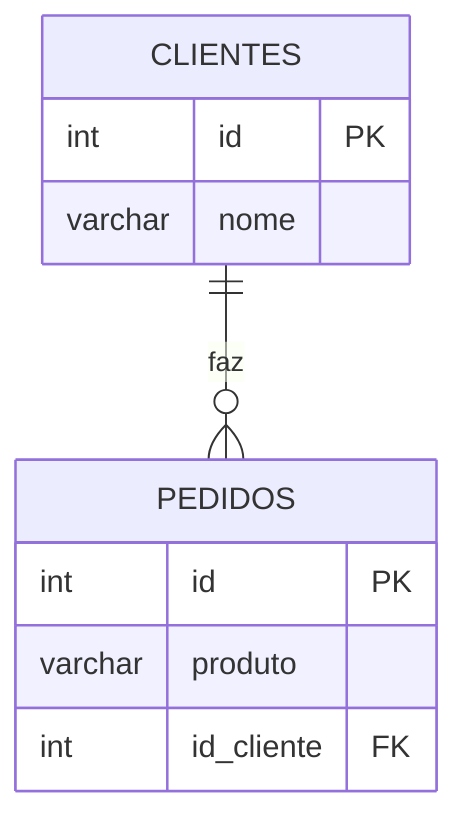

# Aula - Relacionamento de Tabelas

## Ideia principal
- **Clintes**: quem compra.
- **Pedidos**: aquilo que foi vendido.
- Cada pedido, guarda o **número do cliente** (id), não o seu nome.
- O **JOIN** junta duas tabelas para mostrar o nome do cliente do lado do seu pedido.

## Diagrama

-**PH**: O número que indentifica cada cliente e cada pedido.
-**FK**: (Chave estrengeira) O número que irá apontar para a outra tabela.
- ||-o{ Significa que um cliente poderá ter vários pedidos


## Passo a passo

1- Criamos a tabela clientes:
```sql
CREATE TABLE clientes(
    id SERIAL PRIMARY KEY,
    nome VARCHAR(100)
);
```

2- Criamos a tabela de pedidos(criando a chave estrangeira):
```sql
CREATE TABLE pedidos(
    id SERIAL PRIMARY KEY,
    produto VARCHAR(100),
    id_cliente INT REFERENCES clientes(id)
)
```

3- Iseriamos os cliente (Daniele não vai comprar na na cantina):
```sql
INSERT INTO clientes (nome) VALUES
('Caio'),
('Carla'),
('Daniel')
```

4- Inseriamos os produtos para os nossos clientes:
```sql
INSERT INTO pedidos(produto,id_cliente) VALUES
('Pão de queijo',2),
('Café expresso',2),
('Almoço',1)
```

5- Comando INNER JOIN:
```sql
SELECT clientes.nome , pedidos.produto
FROM pedidos
INNER JOIN clientes ON pedidos.id_cliente = clientes.id;
```
- O Daniel não aparece, pois não possui pedido algum.

5- Ultilizando o LEFT
```sql
SELECT clientes.nome, pedidos.produto
FROM clientes
LEFT JOIN pedidos ON clientes.id = pedidos.id_cliente
```
O LEFT: mostra tudo da tabela, da esquerda (basicamente, é a tabela após o FROM).